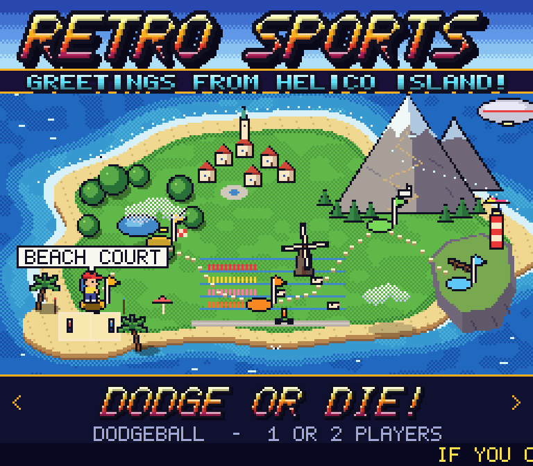
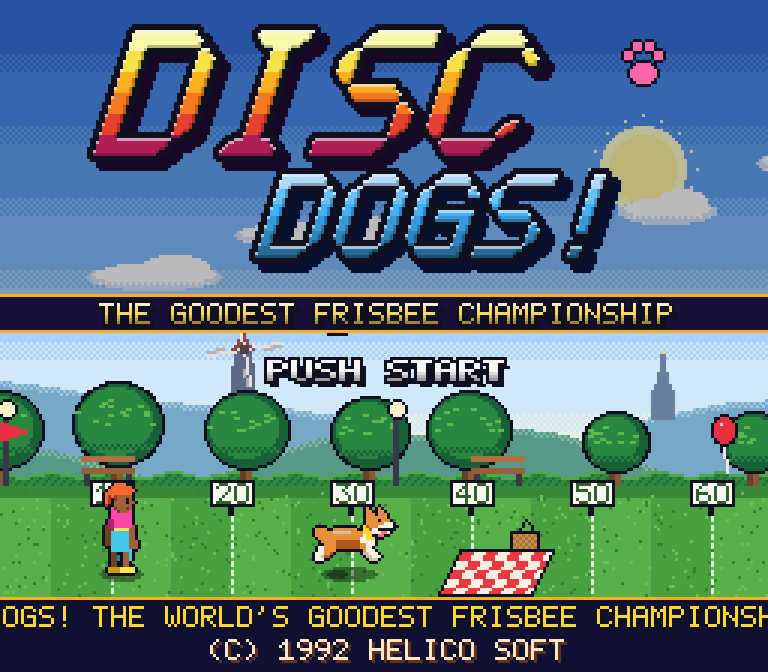
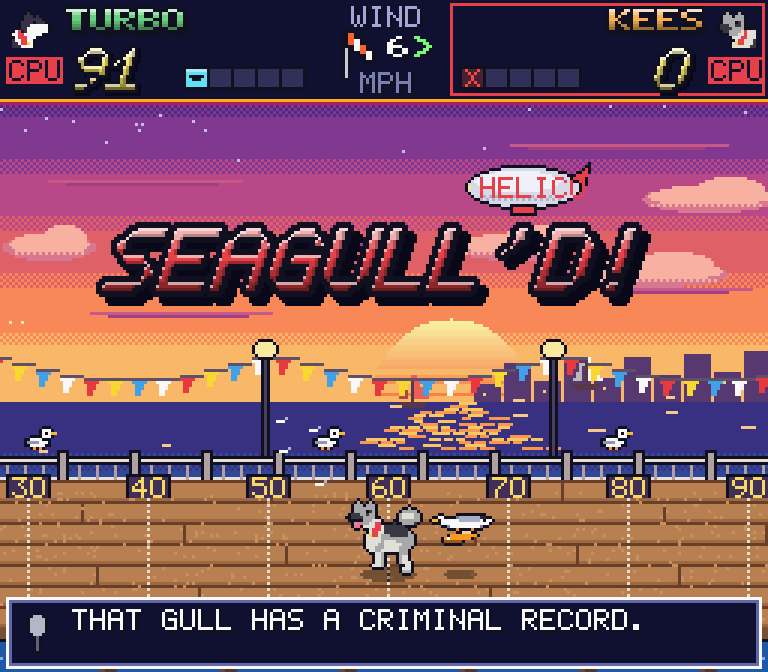
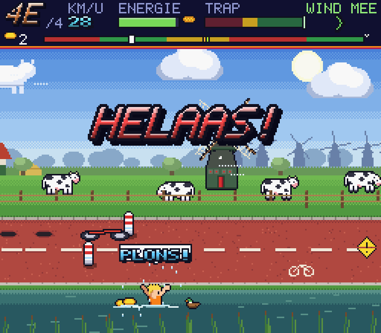
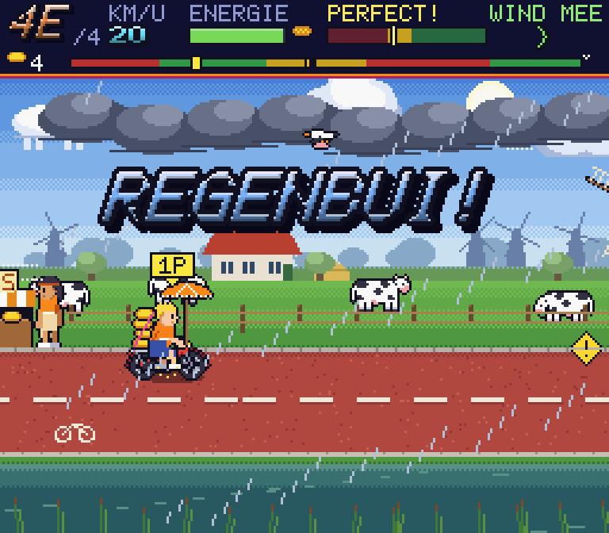
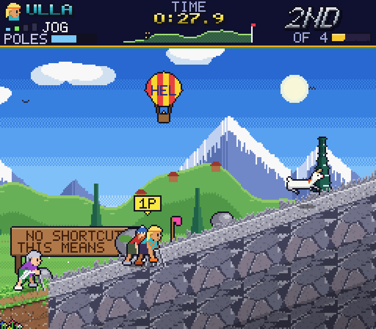
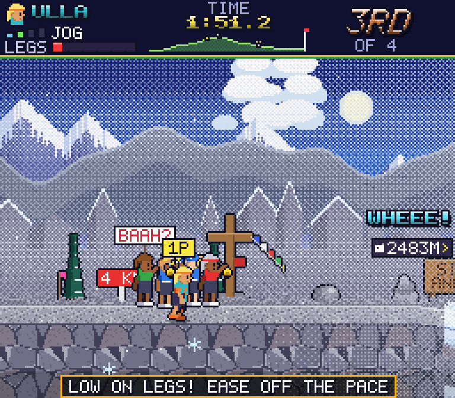
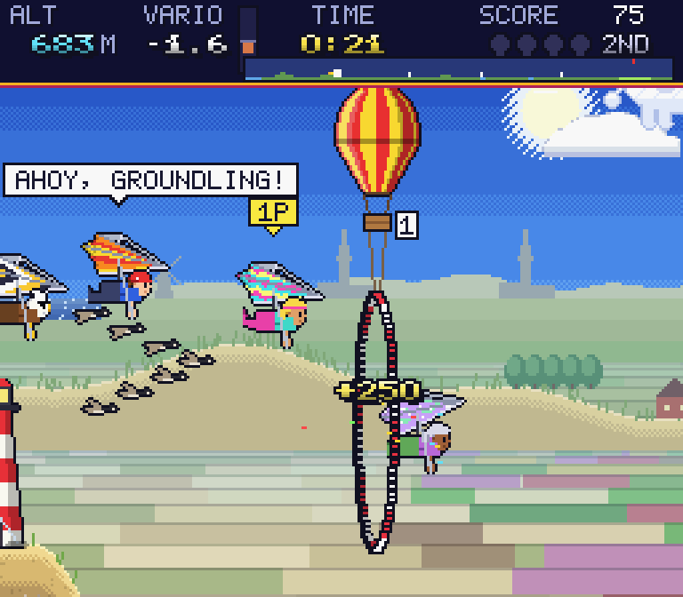
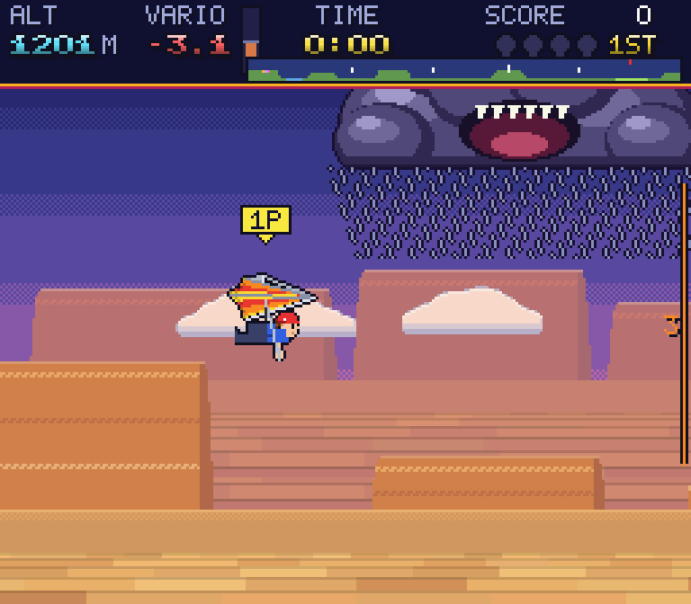

# RETRO SPORTS

*Greetings from Helico Island! Five totally radical sports, 1992 style.*

A collection of 16-bit style sports games in Rust, in the spirit of
California Games, Ski or Die and Super Dodge Ball. Everything you see and
hear is generated in code: a 256x224 software framebuffer (SNES
resolution), pixel-art sprites built from skeleton poses, and a chiptune
synth. Walk the island and pick a game.

**Play in your browser: https://retro-sports.helico.app** (needs a
keyboard; sound starts after your first key press).



## The games
**DODGE OR DIE!** (dodgeball). 3 vs 3 on four courts, four crews, the five
D's of dodgeball, and a coach who throws wrenches when you fall behind.

| | |
|---|---|
|  |  |

**DISC DOGS!** (frisbee). You throw, your dog catches: leap and flip for
up to triple points. Mind the squirrel, the pond and the seagulls on the
pier.

| | |
|---|---|
|  |  |

**TEGENWIND!** (Dutch cycling). Holland's toughest bike race, against the
wind. Pedal in rhythm, tuck, draft, ring your bell at tourists, and try to
deliver the cheese. Oma Riek never stops pedalling.

| | |
|---|---|
|  |  |

**TRAIL MIX!** (trail running). The ultra trail of Mount Helico: pace your
legs, jump roots, power hike with poles, glissade down the snow, and beat
Gerald the goat.

| | |
|---|---|
|  |  |

**HANG TIME!** (hang gliding). Launch off the ramp, ride thermals and the
geese, fly through the balloon hoops, mind the storm cloud, and land on
the cross, not on the sheep.

| | |
|---|---|
|  |  |

Every game has a 1P ladder against the CPU (with continues) and a 2P mode.

## Controls
| | Player 1 | Player 2 |
|---|---|---|
| Move | Arrows | W A S D |
| A (throw, ring, grab) | Z or `,` | F |
| B (jump, hop, flare) | X or `.` | G |
| C (pass, tuck, floater) | C or `/` | H |
| Start / pause | Enter | Tab |

- On the island: arrows walk, Z or Enter plays.
- Esc goes back to the game's title, then to the island (and quits from
  the island, except in the browser). F1 toggles scanlines.
- Each game shows its own controls on its intro cards.

## Download
Get the latest build from the [Releases](../../releases) page.

- **macOS** (Apple Silicon and Intel): unzip `RetroSports-macos.zip` and
  open `Retro Sports.app`. The app is not signed by Apple, so the first
  time right-click it and choose *Open*, or run
  `xattr -dr com.apple.quarantine "Retro Sports.app"`.
- **Windows** (x86_64): unzip `retro-sports-windows-x86_64.zip` and run
  `retro-sports.exe`. Windows SmartScreen may warn because the exe is not
  signed: choose *More info* and then *Run anyway*.
- **Linux** (x86_64): unpack `retro-sports-linux-x86_64.tar.gz` and run
  `./retro-sports`. Needs OpenGL, X11 and ALSA (present on most desktops).

## Build from source
```sh
cargo run --release
```
On Linux you need `libasound2-dev libx11-dev libxi-dev libgl1-mesa-dev`.
On Windows the release build has no console window, so run the developer
tools below from a debug build to see output.

Browser version: `web/build.sh` builds it into `dist/` (needs
`rustup target add wasm32-unknown-unknown`). Serve it with
`python3 -m http.server -d dist` and open http://localhost:8000.

Developer tools, no window needed:
- `cargo run --release -- --shots <dir> [game]` renders screenshots of
  every screen of every game (or one game, or `hub`).
- `cargo run --release -- --sim <game> [n]` prints CPU-vs-CPU balance
  stats; `--probe <game> [n]` plays scripted "human" bots against the CPU
  ladder to find exploits. Games: `dodgeball`, `discdogs`, `tegenwind`,
  `trailmix`, `hangtime`.

See [AGENTS.md](AGENTS.md), [docs/architecture.md](docs/architecture.md)
and [docs/house-style.md](docs/house-style.md) for how it is built.
